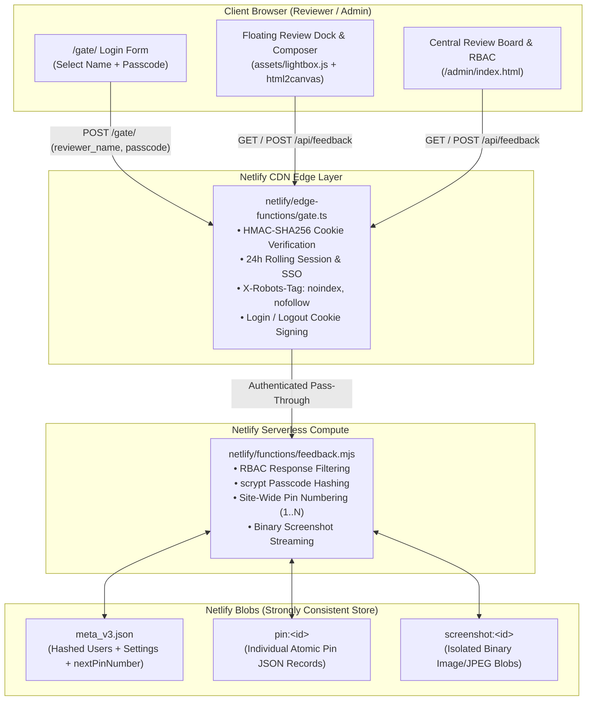

# GreenTree Visual Pin Board & Preview Gate — Complete Team Architecture & Replication Guide

> [!IMPORTANT]
> **Purpose of This Document**
> The **GreenTree Visual Pin Board & Preview Gate** replaces third-party review SaaS subscriptions (BugHerd, Markup.io, Pastel) and scattered client emails with a zero-monthly-cost, self-hosted, enterprise-hardened visual annotation and staging system built natively on **Netlify Edge Functions** and **Netlify Blobs**.
>
> This guide documents the complete architecture, security model, data schema, API contract, AI agent workflow, and a **15-minute drop-in replication checklist** to deploy the Pin Board on any GreenTree client site.

---

## 1. Executive Summary & Capabilities

When staging a new website or iterating with a client (such as Karin at Modzelewski's), traditional feedback loops break down because clients struggle to describe *which* photo, caption, or headline they are looking at on mobile or desktop.

The **Pin Board** solves this by embedding a complete visual feedback suite directly into the staging site behind a cryptographic edge login gate:

1. **Zero-Leakage Edge Authentication Gate (`/gate/`)**: Every route, asset, and API endpoint is intercepted at the CDN edge (`netlify/edge-functions/gate.ts`). Unauthenticated visitors receive HTTP `401` with the login gate UI and `X-Robots-Tag: noindex, nofollow` so search engines never index staging URLs.
2. **Cross-Subdomain Single Sign-On (SSO)**: Logging in once as `Karin` or `Gene` sets an HMAC-SHA256 signed session cookie on `Domain=.greentreehosting.com` (24-hour rolling TTL), authenticating the reviewer across sister properties automatically.
3. **Point-and-Click DOM Targeting & Real Pixel Screenshots**: Clicking **+ Pin Comment** in the floating bottom-right dock lets the reviewer tap any headline, card, gallery image, or button. The client captures the element's CSS selector, text snippet, relative coordinates, and a **real pixel screenshot** (`html2canvas` 1.4.1 with live DOM `` fallback).
4. **Auto-Saved Drafts, Corner-Anchored Markers & Floating Dock v2 (`Pins: ON/OFF`, Shrink-to-Circle & Drag-Anywhere)**:
   - Comments auto-save to `localStorage` as the reviewer types.
   - Submitted pins render as numbered badges (`#1`, `#2`, etc.) anchored to the **top-right corner outside the element's text box** so markers never obscure copy.
   - **`Pins (N): ON / OFF` Toggle**: Clicking `Pins (N): ON` on the floating dock toggles all page markers between `ON` (visible) and `OFF` (hidden) and persists in `localStorage` (`modz_pins_visible_v1`).
   - **Collapse / Shrink to Floating `📌` Circle (`–` $\leftrightarrow$ `📌`)**: Clicking `–` shrinks the toolbar into a compact circular `📌 N` icon; clicking `📌` expands the full bar back (`modz_dock_collapsed_v1`).
   - **Truly Floating Drag-Anywhere + Smart Right/Left Edge Anchoring**: Reviewers can drag the dock via the `⋮⋮` handle or collapsed `📌` circle (`modz_dock_pos_v1`). Pointer capture is deferred until `>= 6px` movement so button clicks are never intercepted, and `measureDockSize()` measures unconstrained `width: max-content` while anchoring the right edge when parked on the right half of the screen so expanding never overflows the viewport.
5. **Dual-Engine Persistence (Coolify Isolated PostgreSQL 16 + Netlify Blobs Fallback) & SmarterMail SMTP**:
   - On Coolify (`apps1.greentreehosting.net`), pins (`pinboard_pins`), metadata (`pinboard_meta`), and website form leads (`form_submissions`) are stored in each site's dedicated PostgreSQL 16 database (`server.mjs`), with automatic fallback to `@netlify/blobs` when running in serverless mode.
   - All form submissions and Pin Board notifications route via GreenTree's **SmarterMail SMTP relay** (`east.greentreemail.com:587`, sender `modz@greentreemail.com`), configurable at runtime via environment variables, `/admin/` settings, or `/api/gt-sync/v1/smtp-config`, and fire real-time HMAC-signed webhooks to the **GreenTree Central Command Center** (`https://command.greentreehosting.com`).
6. **Hardened Role-Based Access Control (RBAC) & `scrypt` Passcodes**: User passcodes are hashed with `crypto.scryptSync` (`scrypt:<salt>:<hash>`) and never returned in API responses. Non-admin reviewers (`Karin`, `Client`) receive **only** the pin list and their own reviewer name from `GET /api/feedback`; user directories and notification settings are restricted strictly to `Super Admin`.
7. **Central Admin Review Board (`/admin/#feedback-board`)**: A unified dashboard to filter pins by status (`Open`, `In Progress`, `Resolved`), category, or reviewer, reply to threads, deep-link directly to the pinned element on the live page (`?pin=<id>`), and manage team credentials.

---

## 2. System Architecture



### Key File Inventory

| File Path | Role & Responsibility |
| :--- | :--- |
| [netlify/edge-functions/gate.ts](file:///c:/repos-greentree/modztowing.com/netlify/edge-functions/gate.ts) | Intercepts `/*`. Validates `modz_preview` / `modz_staff_auth` HMAC-SHA256 cookies, handles `POST /gate/` logins, expires stale host-only cookies, and gates `/api/feedback`. |
| [netlify/functions/feedback.mjs](file:///c:/repos-greentree/modztowing.com/netlify/functions/feedback.mjs) | Primary `/api/feedback` backend using `@netlify/blobs`. Manages atomic `pin:<id>` and `screenshot:<id>` records, `scrypt` password hashing, and `Super Admin` RBAC filtering. |
| [assets/lightbox.js](file:///c:/repos-greentree/modztowing.com/assets/lightbox.js) | Injects the floating `#modzReviewDock`, element hover inspector, `html2canvas` real-pixel screenshot capture, draft auto-save, top-right corner pin markers, and thread modals. |
| [admin/index.html](file:///c:/repos-greentree/modztowing.com/admin/index.html) | Houses the **Site Review & Feedback Board** (`#feedback-board`), status filters, deep-link jumpers, and the `Super Admin` User & Notification Management portal. |
| [gate/index.html](file:///c:/repos-greentree/modztowing.com/gate/index.html) | Clean, branded login screen allowing reviewers to pick their name (or type a custom name) and enter the project preview passcode. |
| [includes/header.html](file:///c:/repos-greentree/modztowing.com/includes/header.html) | Contains the top utility bar's `Admin` link, `Session: 24h 00m` live countdown badge (`#modzSessionTimerBadge`), and `Logout` button. |

---

## 3. Storage Schema & Data Model (`@netlify/blobs`)

To prevent race conditions when two reviewers submit feedback simultaneously—and to keep `GET /api/feedback` fast even when dozens of high-resolution screenshots are attached—the system splits storage across three key namespaces inside the Netlify Blob store (`modz-review-board`):

### 3.1 `meta_v3.json` (Store Metadata & Hashed Users)
Stores global settings, the monotonic `nextPinNumber` counter, and the user directory with `scrypt`-hashed passcodes:

```json
{
  "version": 3,
  "migratedV2": true,
  "nextPinNumber": 9,
  "settings": {
    "notifyEmails": "gene@greentreehosting.com",
    "ccEmails": "",
    "notifyOnNewPin": true,
    "notifyOnStatusChange": true,
    "notifyOnReply": true,
    "requirePasscodeForPin": false
  },
  "users": [
    {
      "id": "usr-gene",
      "name": "Gene",
      "email": "gene@greentreehosting.com",
      "role": "Super Admin",
      "passcodeHash": "scrypt:a1b2c3d4...:9f8e7d6c...",
      "active": true
    }
  ]
}
```

### 3.2 `pin:<id>` (Atomic Per-Pin Record)
Each pin is stored under its own key (e.g., `pin:pin-1792743844744-bf09`). Base64 image data is automatically stripped out of the pin JSON and replaced with a lightweight URL reference (`/api/feedback?screenshot=<id>`):

```json
{
  "id": "pin-1792743844744-bf09",
  "pinNumber": 8,
  "siteDivision": "Modzelewski's Recovery & Heavy Hauling",
  "pagePath": "/gallery/",
  "pageTitle": "Field Recovery & Heavy Hauling Gallery",
  "elementSelector": "article.rounded-2xl:nth-of-type(2) > div.p-4 > p",
  "elementSnippet": "Before: Interior structural collapse...",
  "imageSrc": "https://modztowing.greentreehosting.com/assets/images/gallery/newtown-1.jpg",
  "relX": 0.48,
  "relY": 0.62,
  "reviewerName": "Karin",
  "category": "Photo / Caption",
  "status": "open",
  "commentText": "Swap the interior and exterior captions on these two photos.",
  "hasScreenshotBlob": true,
  "screenshotDataUrl": "/api/feedback?screenshot=pin-1792743844744-bf09",
  "reactions": { "👍": ["Gene"] },
  "replies": [
    {
      "id": "rep-1792744100123",
      "author": "Gene",
      "text": "Swapped and verified on live gallery.",
      "createdAt": "2026-10-23T08:25:00.000Z"
    }
  ],
  "createdAt": "2026-10-23T08:20:44.744Z",
  "updatedAt": "2026-10-23T08:25:00.000Z"
}
```

### 3.3 `screenshot:<id>` (Binary Image Blob)
Stored as a separate record containing `{ contentType: "image/jpeg", base64: "..." }` and streamed back as binary `image/jpeg` with `Cache-Control: private, max-age=86400` when requested via `GET /api/feedback?screenshot=<id>`.

---

## 4. Security Architecture (The 5 Non-Negotiable Rules)

Every deployment of the Pin Board enforces five security invariants audited during staging:

1. **Zero Unauthenticated Access (`401`)**: Every request to `/api/feedback` (or `/.netlify/functions/feedback`) is intercepted by `gate.ts` and `feedback.mjs`. Without a valid HMAC-SHA256 signed `modz_preview` or `modz_staff_auth` cookie, the server immediately returns `401 Unauthorized`.
2. **Role-Gated API Payload (`Super Admin` vs. Reviewer)**:
   - **Non-Admin Session (`Karin`, `Client`, `Reviewer`):** `GET /api/feedback` returns **only**:
     ```json
     {
       "ok": true,
       "persistentDb": true,
       "reviewerName": "Karin",
       "items": [ ... ]
     }
     ```
     There are **no** `users` or `settings` keys in the response.
   - **Super Admin Session (`Gene`):** `GET /api/feedback` additionally includes `"isSuperAdmin": true`, `"users"` (with `passcodeHash` stripped out), and `"settings"`.
3. **Salted `scrypt` Passcode Hashing**: Passcodes are hashed using Node's native `crypto.scryptSync(passcode, salt, 32)` and verified with `crypto.timingSafeEqual`. Plaintext passcodes are never written to disk/blobs and never returned to any client.
4. **Cookie Domain & Precedence Hygiene**:
   - The server sets `modz_reviewer=<Name>; Domain=.greentreehosting.com; Path=/; Secure; SameSite=Lax; Max-Age=86400`.
   - On login (`POST /gate/`) and on page load (`assets/lightbox.js`), any legacy host-only `modz_reviewer` cookie is explicitly expired (`Max-Age=0`).
   - The client never writes a default `"Modz"` cookie or overwrites the server-set cookie with `localStorage`.
5. **Email Notification Safety**: Client email addresses are never placed in `ccEmails` during internal staging unless explicitly enabled by a `Super Admin` at handoff.

---

## 5. Complete API Reference (`/api/feedback`)

### `GET /api/feedback`
- **Query Params**:
  - *(none)*: Returns `{ ok, persistentDb, reviewerName, items }` (plus `isSuperAdmin`, `users`, `settings` if caller is `Super Admin`).
  - `?screenshot=<pinId>`: Streams the binary `image/jpeg` screenshot for `<pinId>`.

### `POST /api/feedback`
Accepts `Content-Type: application/json` with an `action` field:

| `action` | Access Level | Payload Fields | Description |
| :--- | :--- | :--- | :--- |
| `"create"` | Any Authenticated Reviewer | `pagePath`, `pageTitle`, `elementSelector`, `elementSnippet`, `relX`, `relY`, `reviewerName`, `category`, `commentText`, `screenshotDataUrl` | Creates a new pin with the next site-wide unique `pinNumber`, extracts the screenshot into `screenshot:<id>`, and saves `pin:<id>`. |
| `"update_status"` | Any Authenticated Reviewer | `id`, `status` (`"open"` \| `"in_progress"` \| `"resolved"`) | Updates a pin's workflow status atomically. |
| `"reply"` | Any Authenticated Reviewer | `id`, `author`, `text` | Appends a timestamped reply to a pin's discussion thread. |
| `"react"` | Any Authenticated Reviewer | `id`, `emoji`, `reviewerName` | Toggles an emoji reaction (`👍`, `✅`, `👀`, `🔥`) on a pin. |
| `"delete"` | Any Authenticated Reviewer | `id` | Deletes `pin:<id>` and `screenshot:<id>` from Netlify Blobs. |
| `"login_user"` | Gate / Staff Login | `name`, `passcode` | Verifies user credentials against `scrypt` hashes and sets signed `modz_reviewer` & `modz_staff_auth` cookies. |
| `"save_user"` | **Super Admin Only** | `user: { id, name, email, role, passcode, active }` | Creates or updates a user (hashing `passcode` with `scrypt` if provided). Returns `403` for non-admins. |
| `"delete_user"` | **Super Admin Only** | `userId` | Removes a user from `meta_v3.json` (protects the last active Super Admin). |
| `"update_settings"` | **Super Admin Only** | `settings: { notifyEmails, ccEmails, ... }` | Updates notification preferences in `meta_v3.json`. |

---

## 6. 15-Minute Drop-In Replication Guide for New Sites

To add the Pin Board + Preview Gate to any static, Eleventy, Astro, Next.js, or custom HTML site hosted on Netlify, follow these 5 steps:

### Step 1: Install `@netlify/blobs`
In the target project's root directory:
```bash
npm install @netlify/blobs
```

### Step 2: Copy the 4 Core Files
Copy these four files from `modztowing.com` into your target repository:
1. `netlify/edge-functions/gate.ts`
2. `netlify/functions/feedback.mjs`
3. `gate/index.html` *(and include `/gate/` in your static build output if using a build script)*
4. `admin/index.html` *(specifically the `#feedback-board` and RBAC modal sections, or copy the full admin hub)*

And include the Pin Board client script (`assets/lightbox.js` or extracted as `assets/pin-board.js`) plus `html2canvas` on every page before `</body>`:
```html
<script src="/assets/lightbox.js" defer></script>
```

### Step 3: Add the Routing Rules in `netlify.toml`
Add these blocks to the target site's `netlify.toml`:
```toml
[build]
  functions = "netlify/functions"

# Route /api/feedback to the Netlify Blobs serverless function
[[redirects]]
  from = "/api/feedback"
  to = "/.netlify/functions/feedback"
  status = 200

[[redirects]]
  from = "/api/feedback/*"
  to = "/.netlify/functions/feedback"
  status = 200

# Intercept all traffic with the Server-Side Preview Gate Edge Function
[[edge_functions]]
  path = "/*"
  function = "gate"
```

### Step 4: Customize the 3 Site Constants
Open `netlify/functions/feedback.mjs` and `netlify/edge-functions/gate.ts` and update three constants for the new client:
1. **`BLOB_STORE_NAME`** in `feedback.mjs` (line 5):
   - Change `"modz-review-board"` to `"<client>-review-board"` (e.g., `"acme-review-board"`).
   - *Tip:* If two sister sites should share a unified review board, give them the same `BLOB_STORE_NAME`; if they should have separate boards, give each its own store name.
2. **`SITE_DIVISION`** in `assets/lightbox.js` & `feedback.mjs`:
   - Set to the client's brand name (e.g., `"Acme Commercial Roofing"`).
3. **Default Passcode & Seed Users**:
   - Set the `PREVIEW_PASSCODE` environment variable in Netlify (or update the fallback in `gate.ts` and `DEFAULT_USERS` in `feedback.mjs`).
   - If the site is hosted on `*.greentreehosting.com`, cross-subdomain cookie sharing works automatically via `Domain=.greentreehosting.com`. If hosted on a custom staging domain, update `getSharedCookieDomain()` in `gate.ts`, `feedback.mjs`, and `lightbox.js`.

### Step 5: Run the Automated Security Verification Check
After deploying to Netlify, run this quick verification command to confirm non-admin vs. Super Admin isolation:
```bash
node -e '
(async () => {
  const baseUrl = "https://YOUR-SITE.greentreehosting.com";
  const login = async (user, pass) => {
    const res = await fetch(baseUrl + "/gate/", {
      method: "POST",
      headers: { "Content-Type": "application/x-www-form-urlencoded" },
      body: new URLSearchParams({ reviewer_name: user, passcode: pass, next: "/" }).toString(),
      redirect: "manual"
    });
    return (res.headers.getSetCookie ? res.headers.getSetCookie() : [res.headers.get("set-cookie") || ""])
      .map(c => c.split(";")[0].trim()).filter(Boolean).join("; ");
  };

  const reviewerCookies = await login("ClientReviewer", "YourPasscode");
  const revRes = await (await fetch(baseUrl + "/api/feedback", { headers: { Cookie: reviewerCookies } })).json();
  console.log("Non-Admin keys (must NOT contain users/settings):", Object.keys(revRes), "reviewerName:", revRes.reviewerName);

  const adminCookies = await login("Gene", "YourPasscode");
  const admRes = await (await fetch(baseUrl + "/api/feedback", { headers: { Cookie: adminCookies } })).json();
  console.log("Super Admin keys (MUST contain users/settings):", Object.keys(admRes), "isSuperAdmin:", admRes.isSuperAdmin);
})();
'
```

---

## 7. AI Agent & Developer Resolution Workflow

One of the biggest multipliers of the Pin Board is that **AI coding agents (like Antigravity) can read, fix, reply to, and resolve client pins directly via the API**:

1. **Fetch Open Pins**: The agent authenticates against `/api/feedback` and filters `items.filter(i => i.status !== "resolved")`.
2. **Inspect Context & Real Screenshot**: Each pin gives the agent the exact `pagePath` (e.g., `/gallery/`), the CSS `elementSelector`, the text `elementSnippet`, the `imageSrc` (if an image was clicked), and the visual screenshot at `/api/feedback?screenshot=<id>`.
3. **Apply Code Fix & Verify**: The agent edits the corresponding HTML/JS/CSS file, runs `npm run build && npm run verify`, and pushes to `main`.
4. **Close the Loop on the Board**: The agent sends a `POST /api/feedback` with `action: "reply"` explaining the fix and `action: "update_status"` (`status: "resolved"`), so the client sees a green checkmark and resolution note the next time they open the board.
